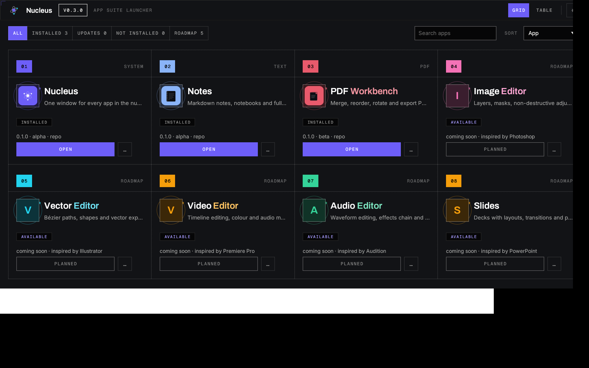

<div align="center">

# Nucleus

### The creative suite that runs itself.

**One command bus. Every app speaks GUI, CLI and MCP.**
**Drop-in plugins in native WebView2 windows — no Electron, no install wizard.**

[](https://github.com/Skeabby/nucleus/actions/workflows/ci.yml)
[](./LICENSE)
[](#)
[](https://nodejs.org)
[](https://github.com/Skeabby/nucleus/stargazers)
[](https://github.com/Skeabby/nucleus/pulls)



</div>

---

> **The GUI, the terminal, and your AI agent all run the exact same commands.**
> Nucleus hosts small creative apps as plugins, and every app exposes one command bus through a web
> UI, a CLI, a JSON-RPC endpoint and an MCP server. Drive it by clicking, scripting, or prompting —
> the results are identical.

<!-- TODO: record a 20-40s demo GIF, drop it in docs/, and replace this note. -->
<p align="center"><em>Demo GIF coming soon (<code>docs/demo.gif</code>)</em></p>

---

## Why it's different

Most creative suites are either a heavy Electron shell or a pile of disconnected tools. Nucleus takes a
different route:

- **Agent-first, not agent-bolted-on.** MCP is a first-class frontend, not an afterthought. An AI
  agent can do everything a human can, because it talks to the *same* command bus.
- **Apps are just folders.** Drop a directory with a `nucleus.app.json` manifest into `apps/` and it
  appears in the launcher. No registry, no rebuild, no plugin SDK to learn.
- **Native windows in ~11 KB.** A tiny WinForms + WebView2 host renders each app in a real desktop
  window with taskbar identity and its own icon — compiled with the `csc.exe` already on Windows.
- **One core to rule the suite.** `@nucleus/core` owns the document model, a command bus and
  undo/redo. Frontends are thin adapters, so features land once and become available everywhere.
- **A launcher that looks the part.** An app-store grid: big icons, status and version, sectioned
  Apps / Coming soon, a prominent Open button, search, grid/table views and light/dark themes.

## Apps

| App | Status | What it does |
|-----|--------|--------------|
| **Nucleus launcher** | alpha | Every app in one window: search, grid/table, Open / Stop, themes. |
| **PDF Workbench** | beta | Merge, reorder, rotate, delete pages, undo/redo, save/open projects, export. |
| Image Editor | planned | Layers, masks, non-destructive adjustments and export. |
| Vector Editor | planned | Bézier paths, shapes and vector export. |
| Video Editor | planned | Timeline editing, colour and audio mixing. |
| Audio Editor | planned | Waveform editing, effects chain and mastering. |
| Slides | planned | Decks with layouts, transitions and present mode. |
| Notes | planned | Markdown notes, notebooks and full-text search. |

## Quickstart (Windows)

```powershell
npm install
npm run build
npm start          # opens the Nucleus launcher window
```

Click **Open** on *PDF Workbench* — it starts on a free port in its own window. Close the
launcher window to shut the whole nucleus down.

### Make it a real desktop app

```powershell
npm run shell      # (one-time) build the native window shell -> assets\nucleus-shell.exe
npm run shortcut   # create "Nucleus.lnk" on the desktop, with an icon
```

Double-click **Nucleus** like any other Windows app.

## How it works

```
                ┌──────────────────────────── frontends ────────────────────────────┐
                │  launcher UI   CLI (control-cli)   JSON-RPC   MCP (control-mcp)     │
                └───────────────┬───────────────┬──────────────┬──────────────┬───────┘
                                │               │              │              │
                                └───────────────┴──────┬───────┴──────────────┘
                                                       ▼
                                          ControlServer  (transport-agnostic)
                                                       ▼
                              CommandBus  ·  document model  ·  undo/redo  ·  serialization
                                                       ▲
                                    app command packs (e.g. @nucleus/pdf)
```

The **launcher** scans `apps/*/nucleus.app.json` and `%APPDATA%\Nucleus\apps`, picks a free port
per app, spawns `node <app>` detached with a `PORT` env var, waits for a readiness probe, and opens
a native window at the app root. It stays alive so closing the launcher shuts down the apps it owns.

## Monorepo layout

```
packages/core         # document model, command bus, undo/redo, serialization
packages/control      # ControlServer: invoke / describe / list / history
packages/control-cli  # CLI frontend
packages/control-rpc  # JSON-RPC frontend (Phase 2 placeholder)
packages/control-mcp  # MCP frontend (dependency-free JSON-RPC 2.0 over stdio)
packages/pdf          # @nucleus/pdf command pack (import / rotate / move / remove / export)
packages/launcher     # app discovery, manifests, process runtime, windows, CLI
apps/launcher         # the launcher window (grid/table UI + /api/apps)
apps/pdf-workbench    # app #1: local HTTP server + web UI
schemas/              # JSON Schema - the source of truth for codegen
tools/                # codegen, validators, screenshot capture
shell/                # native window host (WinForms + WebView2)
scripts/              # shell build, desktop entry point, shortcut installer
```

Every app is just a folder with a `nucleus.app.json` manifest describing what it is and how to
launch it — that is all the launcher needs to discover and run it.

## Commands

```bash
npm run verify            # build + typecheck + test (via turbo)
npm run build
npm run test
npm start                 # open the Nucleus launcher
npm run nucleus -- list   # list discovered apps
npm run nucleus -- open nucleus.pdf-workbench
npm run nucleus -- serve  # launcher server only, no window
npm run start:pdf         # run PDF Workbench directly
npm run mcp               # run the MCP server over stdio
```

## Agent-ready (MCP)

The nucleus MCP server is registered in [`.opencode/mcp.json`](./.opencode/mcp.json) and exposes
curated PDF tools plus a generic `cmd_invoke` escape hatch — see
[`.opencode/README.md`](./.opencode/README.md). Any MCP-capable agent can drive the same
command bus as the GUI, so the whole suite is scriptable *and* promptable.

## Roadmap

The phased plan, design decisions and risks live in [`ARCHITECTURE.md`](./ARCHITECTURE.md).
Short version: launcher + first app (**done**) → more apps → JSON-RPC frontend → optional Tauri
packaging for cross-platform native bundles.

## Contributing

PRs and issues are welcome — this is a young project and the plugin/manifest model is the most
interesting thing to poke at. Run `npm run verify` before opening a PR.

If Nucleus is useful or just neat, a **star** helps other people find it.

## License

[MIT](./LICENSE) © Nucleus contributors.
